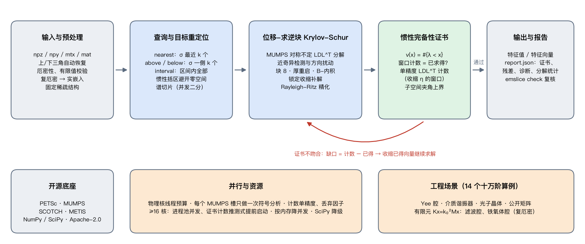

---
header-includes:
  - \renewcommand{\figurename}{图}
  - \renewcommand{\tablename}{表}
---

# emslice：电磁谐振模式求解，一个不漏，并给出证据

> 2026 上海开源软件应用创新大赛 · AI+工业软件赛道 · 中国商飞企业命题\
> 「面向电磁谐振与微波器件仿真的高效、稳定求解方案」 · 开源协议 Apache-2.0\
> 详细技术方案见《方案说明文档》（算法原理、复杂度、收敛性、诊断流程、完整评测）

## 一、项目背景

微波滤波器、天线、环行器、光子晶体等器件的设计，都要计算结构的**谐振频率与模式**。电磁仿真软件把麦克斯韦方程离散后，这一步归结为十万阶以上的稀疏厄密特征值问题；由于梯度零空间、材料与位移，矩阵**非正定**。

工程上最怕的不是慢，而是**漏掉谐振模式**：漏掉一个寄生模，滤波器就可能在带内出现意外的谐振。现有开源工具（SLEPc、SciPy/ARPACK）只保证“求出来的是特征对”（残差小），不保证“没有漏”；在任务书点名的困难场景——目标频率恰为谐振点、重特征值、低频零空间——常规用法会给出错误结果甚至空结果，而且**不报错**。

## 二、技术架构

核心是一条“求解—核对—补解”的闭环：位移-求逆块 Krylov-Schur 负责求，**Sylvester 惯性定理**负责核对——对称不定分解 $LDL^T(A-xB)$ 的负主元个数精确等于小于 $x$ 的特征值个数，与迭代过程完全独立。计数与已求得个数一致，即**证明**目标窗口内没有遗漏；不一致则按缺口自动补解。

## 三、技术创新（对应评审维度：技术创新）

| 创新点 | 解决的问题 | 现有方案的表现 |
|------|------------|--------|
| **惯性完备性证书** | 每次求解给出“窗口内无遗漏”的可审计证据，并驱动自动补解 | 只有残差，无完备性保证 |
| **近奇异位移自适应** | 目标频率恰为/贴近谐振点（相对差 1e-13）时自动检测并按局部谱尺度扰动 | SLEPc 后向误差 0.12、漏 2 个简并模式；SciPy 1e-2 |
| **惯性引导目标重定位** | 低频击穿：数万维梯度零空间挡在目标前，先用惯性计数括区再求解 | SLEPc 返回 0 个有效结果（Yee 与有限元矩阵均如此） |
| **复厄密实嵌入** | MUMPS 无厄密 $LDL^H$；实嵌入同时给出可靠惯性与求解，只需实数版 PETSc | 常规做法无惯性可用 |
| **混合精度惯性证书** | 证书计数只要惯性，改用单精度 $LDL^T$（快 2 倍、内存减半）。单精度惯性是邻近矩阵的精确惯性，证书只对收缩 $\eta$ 后的窗口下结论；用已得特征值与 Krylov 额外 Ritz 值估计谱间隙放端点，无干净间隙时自动用双精度 | 混合精度通常只用于求解、不碰正确性判据 |
| **可证明的子空间夹角上界** | Davis–Kahan $\sin\Theta\le\|R\|/\delta$ 中的谱间隙 $\delta$ 由证书窗口保证，给出每个特征向量与真实谱子空间夹角的严格上界 | 不知道附近有没有漏掉的特征值，$\delta$ 无从得知 |
| **资源感知并行** | 物理核线程预算；符号分析（不随线程扩展）每个 MUMPS 槽只做一次、实矩阵用 SCOTCH；多核时证书计数在 Krylov 中途推测式提前启动 | — |

## 四、场景落地（对应评审维度：场景落地）

**真实形态的工程矩阵**：除 Yee 差分算子（有解析真值）与 SuiteSparse 公开电磁矩阵外，项目自带有限元生成器（Nédélec 棱边元，gmsh 网格），构造电磁 FEM 软件实际产生的广义问题 $Kx=k_0^2Mx$：

* **介质谐振器滤波腔**（$\varepsilon_r=38$ 陶瓷 + PTFE 支撑）：TE01δ 主模 3.356 GHz 及其后的寄生模；
* **铁氧体加载腔**（旋磁张量，复厄密）：反向旋转模劈裂 7.03/7.13 GHz，即环行器工作原理；
* **空腔**：前 20 阶频率与解析解误差 ≤ 0.14%，验证“矩阵 → 求解 → 物理量”整条链路。

**评测**（14 个十万阶算例，单机）：emslice 全部证书通过、后向误差 ≤ 4e-11；在任务书列出的困难场景中 SLEPc/SciPy 常规用法出现精度崩溃、漏解或空结果。有限元算例上 emslice 含证书的耗时也低于 SLEPc，比 SciPy 快约 25 倍。

| 算例（n≈10 万） | emslice（含证书） | SLEPc | SciPy |
|---|---|---|---|
| 目标频率恰为 6 重谐振点 | 13.9 s √ | 5.3 s **后向误差 0.12，漏 2 个** | 386 s |
| 低频：σ≈0 以上 20 个物理模式 | 21.4 s √ | 62.7 s **返回 0 个** | 327 s |
| 有限元空腔低频（1.3 万维零空间） | 15.9 s √ | 196 s **返回 0 个** | 378 s **误差 2e-6** |
| 介质谐振器 5 GHz 附近 20 个 | 15.6 s √ | 20.4 s | 406 s |
| 铁氧体腔（复厄密）8.5 GHz 附近 | 51.0 s √ | 58.7 s | **超时** |

**部署与平台**：conda 一条命令安装，`emslice solve/gen/check/info` 命令行与 Python API；输入 numpy/scipy/mtx/mat，输出 numpy/scipy 格式与 `report.json`（证书、残差、诊断）。已在 macOS（Apple M2）、Linux aarch64 容器、**华为鲲鹏 640 核服务器 + openEuler 22.03** 上验证，x86-64 Linux 由 CI 覆盖。

**多核扩展性**（鲲鹏单 NUMA 节点，1–32 线程）：十万阶复厄密算例从 525 s 降到 33.7 s，**加速 15.6 倍**，24 次运行全部证书通过；同条件下 SLEPc 加速 8.5 倍且结果错误。实数算例 8 线程后稳定在 8–14 s。

## 五、开源治理（对应评审维度：开源治理）

* **协议与依赖合规**：Apache-2.0；核心依赖 PETSc、MUMPS、METIS、NumPy/SciPy 均为宽松开源协议；GPL 的 gmsh 只作为外部程序生成基准网格、不链接进项目；无闭源服务。
* **贡献机制**：贡献指南（开发环境、提交前检查、基准对比要求）、Issue/PR 模板、行为准则、维护者与决策规则、安全漏洞私密报告渠道。
* **质量保障**：GitHub Actions 持续集成——Linux/macOS 完整后端 + Python 3.9/3.12 降级模式，含“生成 → 求解 → 复核 → 证书”端到端冒烟；20 项单元与场景测试；`bench/fuzz.py` 随机压力测试与稠密真值逐一比对（四种查询、实/复、标准/广义、σ 恰为特征值）。
* **可复现**：`environment.yml` 锁定 conda-forge 依赖、`Dockerfile`、`scripts/reproduce.sh` 一键复现全部基准；测试矩阵由脚本确定性生成、逐字节可复现；更新日志遵循语义化版本。
* **安全设计**：禁用 pickle 反序列化；日志与报告只含形状、非零元数与 SHA-256 摘要；`--secure` 输出 0600 权限；无硬编码、不读参考答案。

## 六、长期发展（对应评审维度：长期发展）

| 阶段 | 内容 |
|----|----------------------|
| v0.2（2026.10） | 有限元场景、降级模式、Linux/鲲鹏验证；混合精度惯性证书、子空间夹角上界、推测式证书计数、随机压力测试（已完成）；接入命题方样例数据 |
| v0.3 | σ 远离谐振点时的单精度分解 + GMRES 精化求解；MPI 分布式谱切片，目标百万阶；外存自动启用 |
| v1.0 | 发布 PyPI / conda-forge；与 NGSolve、MFEM、Elmer 等开源有限元软件对接；向上游贡献原生复厄密 $LDL^H$ 惯性；PML 非厄密问题的可用边界与诊断 |

**治理结构**：维护者名单与决策规则见 `MAINTAINERS.md`、`CONTRIBUTING.md`；影响证书正确性或公开接口的改动须先开 Issue 讨论。

**团队**：（待填写：成员、分工、单位）
