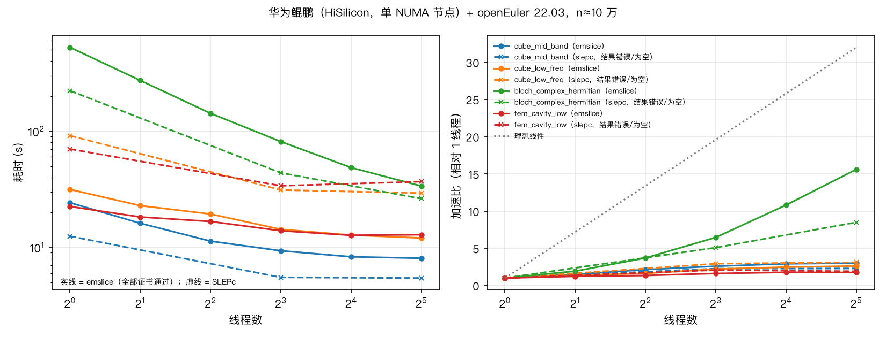
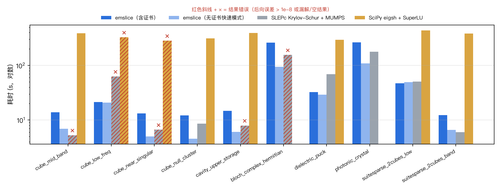
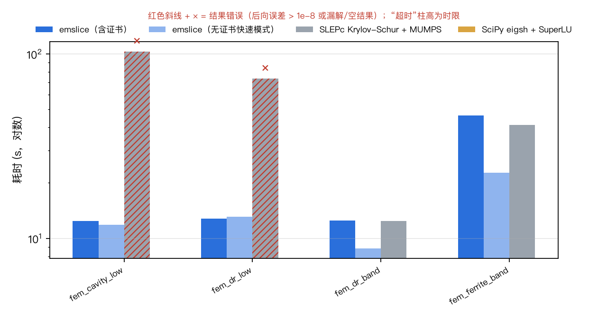
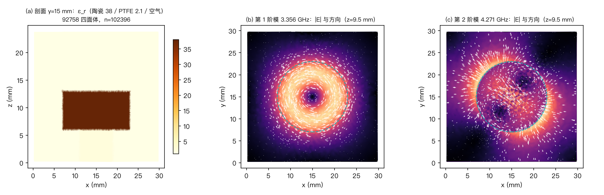

# emslice：面向电磁谐振与微波器件仿真的大规模非正定厄密稀疏特征值求解方案

> 2026 上海开源软件应用创新大赛 · AI+工业软件赛道 · 中国商飞赛题\
> 代码仓库：`comac-emslice`（Apache-2.0） 版本 0.1.0

---

## 1. 概述

电磁仿真中的谐振模式计算（谐振腔、介质滤波器、天线、光子晶体带隙）归结为大规模稀疏厄密特征值问题

$$A x = \lambda x \quad(\text{或广义 } A x = \lambda B x,\ B \succ 0)$$

由于材料色散、梯度零空间、位移等因素，$A$ 往往**非正定**；工程上关心的是**目标频段**（目标位移 $\sigma$ 附近）的谐振模式，最怕的不是慢，而是**漏掉模式**——漏掉一个谐振点，设计就可能出错。

emslice 的核心主张：**目标频段的谐振模式一个不漏，并给出可审计的证据。**

| 能力 | 结果（10 万阶，单机） |
|---|---|
| 完备性 | 基于 Sylvester 惯性定理的“惯性证书”，每次求解给出窗口内特征值个数的独立计数并与已求得个数核对；全部基准算例证书通过 |
| 精度 | 后向误差 ≤ 1e-10（多数 1e-12 ~ 1e-16）；与解析真值的特征值误差 ~1e-16·‖A‖ |
| 重特征值 / 密集谱 | 立方腔 6 重、12 重简并，3.2 万重梯度零空间，均自动补全 |
| 近奇异位移 | σ 与谐振点相差 1e-13 时自动检测、按局部谱尺度扰动 |
| 复厄密 | 实嵌入 + 实对称 LDLᵀ，惯性可靠；Bloch 周期边界光子晶体验证通过 |
| 性能 | 10 万阶实对称：含证书 12–21 s，快速模式 4.5–7 s（与 SLEPc 同量级）；复厄密快速模式比 SLEPc 快 1.6 倍；比 SciPy 快 20–80 倍 |
| 有限元工程场景 | Nédélec 棱边元广义问题 $Kx=k_0^2Mx$：介质谐振器滤波腔、铁氧体加载腔（复厄密）、空腔（与解析解频率误差 ≤0.14%）；含证书耗时均低于 SLEPc |
| 对比 | 任务书列出的困难场景中，SLEPc/SciPy 常规用法出现精度崩溃（后向误差 1e-4 ~ 1e-1）、漏解或空结果，emslice 全部正确（第 9 节，共 14 个十万阶算例） |

---

## 2. 问题定义与求解边界

### 2.1 输入与输出

| 项 | 说明 |
|---|---|
| 矩阵 $A$ | $n\times n$ 厄密（实对称或复厄密），可不定、可半正定、可含大零空间；稀疏存储 |
| 质量矩阵 $B$（可选） | 厄密正定；缺省为单位阵。有限元离散时即质量阵 $M$（`--B`），问题为 $Kx=k_0^2Mx$ |
| 格式 | `.npz`（scipy.sparse.save_npz 或含 data/indices/indptr、row/col/data 的 numpy 归档）、`.npy`、`.mtx`、`.mat` |
| 三角存储 | 仅存上/下三角时自动识别并恢复完整矩阵（`--triangle` 可强制） |
| 查询 | `nearest`：距 σ 最近的 k 个；`above`/`below`：σ 以上/以下的 k 个；`interval`：区间内全部 |
| 输出 | 特征值、特征向量（`.npy`/`.npz`/`.mat`），`report.json`（残差、证书、分解统计、诊断） |

### 2.2 求解边界（适用与不适用）

* **适用**：厄密（含复厄密）矩阵；稀疏直接分解可承受的规模（单机 16–32 GB：三维问题实数约 $10^6$ 阶、复数约 $3\times10^5$ 阶）；任意谱分布，包括重特征值、零附近密集谱、位移贴近特征值。
* **非厄密问题不在本题范围**：含 PML/有耗材料的 FEM 得到的是复对称（$A=A^T$）而非厄密矩阵，特征值为复数，惯性定理不适用。输入校验会拒绝非厄密矩阵（`--symmetrize` 可显式取厄密部分）。
* **精度边界**：任何向后稳定算法的特征值绝对误差下限约为 $\varepsilon\|A\|$。对谱跨度极大的矩阵（如 2cubes_sphere，$\|A\|\approx4\times10^{10}$，关心的特征值 ~40），相对 $\|A\|$ 的后向误差会很小，而小特征值的相对误差受此下限约束；报告同时给出绝对残差、后向误差与相对残差三种度量，便于判断。
* **规模边界**：内存不足时，分解前由 MUMPS 分析阶段估计内存；惯性计数分解丢弃因子（内存约减半）；并发数按可用内存自动下调。

---

## 3. 算法原理

### 3.1 位移-求逆谱变换

取位移 $s$，算子 $T=(A-sB)^{-1}B$ 在 $B$-内积下自伴，特征对为 $(\theta,x)$，$\theta=1/(\lambda-s)$。距 $s$ 最近的特征值变为 $|\theta|$ 最大者，Krylov 方法对谱两端收敛最快，因此位移-求逆是求内部特征值的标准做法。$A-sB$ 用稀疏对称不定 $LDL^T$（MUMPS，Bunch–Kaufman 型 1×1/2×2 主元）分解一次，之后每次作用算子只需前代/回代。

### 3.2 厚重启块 Krylov-Schur（自研）

`emslice/krylov.py` 实现自伴算子的厚重启块 Lanczos（即对称情形的 Krylov-Schur）：

1. 块尺寸 $p$（默认 8），基 $V\in\mathbb{C}^{n\times(m+p)}$ 列主序存储；
2. 每步对新块做两遍经典 Gram-Schmidt（DGKS）完全再正交化，块内用改进 GS 处理秩亏，失效时以随机正交方向补齐并将耦合系数置零；
3. 投影矩阵 $H=V^HTV$ 对角化得 Ritz 对，残差 $\|E s_i\|$；
4. 厚重启保留 $l$ 个期望 Ritz 向量及耦合行，基规模恒定；
5. 锁定集 $X_L$：与已知特征向量 $B$-正交地收缩，用于找回漏解；
6. 停滞检测：收敛个数连续若干次重启不增长时返回已收敛子集，由上层证书驱动补解（比硬迭代快得多）。

选择块方法的原因：块 Krylov 空间中一个 $q$ 重特征值最多出现 $p$ 个副本。电磁结构的对称性产生大量重特征值（立方腔 3/6/12 重），块尺寸 8 一次容纳重数 ≤8 的简并；更高重数由证书发现、收缩后补齐。MUMPS 求解 8 个右端与 4 个耗时相当（实测 n=2.2 万：57 ms vs 59 ms），块化几乎不增加成本。

### 3.3 完备性证书（核心创新）

**Sylvester 惯性定理**：$A-xB$ 的 $LDL^T$ 分解中负主元个数 $\nu(x)=\#\{\lambda_i<x\}$。于是任意区间 $(a,b)$ 内特征值个数 $=\nu(b)-\nu(a)$，与特征向量的求解过程完全独立。

**最近 k 个的内窗口证书**：设已求得距 σ 最近的 $k$ 个特征值，第 $k$ 个距离为 $r_k$。取
$$\rho=r_k-\max(10^{-7}r_k,\ 10^{-11}\|A\|),$$
计算 $c=\nu(\sigma+\rho)-\nu(\sigma-\rho)$，若 $c$ 等于已求得且距离 $<\rho$ 的个数，则**严格不存在被遗漏的更近特征值**；与第 $k$ 个等距的重特征值视为并列（任取其一均为正确答案）。若 $c$ 更大，则缺口 = $c-$已得，自动以已得向量为锁定集、块尺寸 ≥ 缺口+1 继续求解，直到计数吻合。

**区间/切片证书**：区间 $[a,b]$ 内全部特征值个数 $\nu(b)-\nu(a)$ 已知，切片内求得个数必须与之相等。

传统 ARPACK/SLEPc 只保证“求得的是特征对”（残差小），不保证“没漏”；在重特征值与密集谱下漏解是常见失败模式（见第 9 节立方腔算例：首轮 Krylov 只得到 10 个，证书发现另有 2 个更近的简并副本）。

### 3.4 近奇异位移的自适应处理

σ 贴近或恰为谐振点时 $A-\sigma B$ 近奇异：惯性符号不可靠、求解放大舍入误差。

* **检测**：(i) MUMPS 零主元检测（惯性计数分解用相对阈值 $10^{-10}\|A\|$，实测可识别 $10^{-13}$ 相对距离内的特征值）；(ii) 一次随机右端探针求解估计 $\|S^{-1}\|\|S\|$，超过 $10^{12}$ 判为近奇异。
* **处理**：按 $\|A\|$ 尺度逐级扰动（$10^{-10},10^{-8},\dots$），并按查询方向选择符号（`above` 向下、`below` 向上，保证贴近 σ 的特征值仍落在所求一侧）；切片二分时扰动量限制在片宽 10% 内，保证区间严格收缩。
* **预偏移与局部尺度**：算子位移先取 $\sigma+0.62\times10^{-9}\|A\|$，σ 恰为谐振点时免去一次“检测→重分解”。偏移太小 cond 过大、求解噪声会污染远处特征对（实测 $10^{-11}$ 时后向误差 1e-10，$10^{-9}$ 时 1e-12）；偏移太大则在谱跨度极大的矩阵上改变“最近”的集合。因此求得局部半径 $r_k$ 后若偏移 >1% $r_k$，按局部尺度 $10^{-4}r_k$ 重分解并以已得向量热启动。
* **Krylov 噪声地板**：向后稳定求解的误差 $\approx S^{-1}\delta S\,x$ 集中在 $|\theta|$ 最大的方向上；只对主导簇（$|\theta|\ge\tfrac12\max|\theta|$）放宽收敛阈值至 $10\sqrt m\cdot\varepsilon\,\mathrm{cond}(S)\max|\theta|$，其余 Ritz 对仍按严格阈值。此修正使“σ 恰在 3.2 万重零空间上”的算例从 1360 次算子作用降到 64 次（21×）。

### 3.5 低频击穿与零空间：惯性引导的目标重定位

旋度-旋度算子 $\nabla\times\nabla\times$ 的梯度场构成巨大零空间（Yee 网格 33³ 上维数 32768），这就是“低频击穿 / 零附近密集谱”。若要“σ（≈0）以上的前 k 个物理模式”，在 σ 处位移-求逆时零空间映射为 $\theta\approx-1/\sigma$，其模远大于目标 $\theta$，相对间隙仅 ~1e-7，Krylov 几乎停滞。

做法（`above`/`below` 模式）：先用惯性计数括出含 $[k,2k+8]$ 个特征值的区间 $[\sigma,b]$，再把位移放在区间中部求解。括区策略：首批并发计数点 $\{d_0, 16d_0, 10^{-3}d_0\}$；下端计数为 0 时在对数尺度等分（每批缩小 $w+1$ 倍）；有正计数后按幂律 $c\propto d^\alpha$ 插值。谱跨度 $10^{9}$ 的公开矩阵 2cubes_sphere 上从 34 次计数降到 13 次。

### 3.6 复厄密矩阵：实嵌入

MUMPS 的复数 $LDL^T$ 是“复对称”而非“厄密”，不能给出厄密惯性。本方案将 $H=H_r+iH_i$ 嵌入
$$M=\begin{pmatrix}H_r&-H_i\\H_i&H_r\end{pmatrix}\in\mathbb{R}^{2n\times2n}.$$
$H_r$ 对称、$H_i$ 反对称 $\Rightarrow$ $M$ 实对称；若 $Hx=\lambda x$，$x=u+iv$，则 $[u;v]$ 与 $[-v;u]$ 均为 $M$ 的 $\lambda$-特征向量，故**谱$(M)$ = 谱$(H)$ 各重数翻倍，惯性$(M)=2\times$惯性$(H)$**；求解 $(H-\sigma)x=b$ 等价于 $M_\sigma[x_r;x_i]=[b_r;b_i]$。Krylov 迭代仍在 $\mathbb{C}^n$ 上进行，特征值不翻倍。代价与复数 LU 相当（2n 阶实 $LDL^T$ ≈ n 阶复 LU），且只需实数版 PETSc。

### 3.7 精化

Krylov 结束后在子空间上做 Rayleigh-Ritz（对重/密集特征值给出最优基），再视需要做至多 2 次块逆迭代，直到后向误差 ≤ tol。

---

## 4. 复杂度分析

记 $n$ 阶、三维网格类稀疏结构（每行 ~13 个非零元）。

| 阶段 | 计算量 | 内存 | 次数 |
|---|---|---|---|
| 符号分析（METIS 排序） | $O(\mathrm{nnz}\log n)$ | $O(\mathrm{nnz})$ | 每个稀疏结构 1 次（跨位移复用） |
| 数值 $LDL^T$ | 嵌套剖分 $O(n^2)$；实测 33³ 立方腔 7.4e10 flops | 因子 $O(n^{4/3})$；实测 5.0e7 项 / 0.6 GB | 主位移 1 次 + 惯性计数若干次 |
| 每次算子作用（p 个右端） | $O(p\cdot\mathrm{nnz}(L))$ | — | Krylov 总作用次数（实测 64–360） |
| 再正交化 | 每块 $O(n\,m\,p)$，每轮重启 $O(n m^2)$ | 基 $O(nm)$ | — |
| Rayleigh-Ritz | $O(nk^2+k^3)$ | $O(nk)$ | 1–3 次 |

典型 10 万阶实数问题的耗时结构：主位移分解 3–4 s，Krylov 1–5 s，证书计数 2 次（并发）3–5 s。复数周期边界（三维环面）分解代价约为同结构实数的 8 倍（实测 2.9e12 flops），这是复数运算 + 嵌入的固有代价（与复数 LU 相当）。

排序比较（33³ 立方腔，同一位移）：

| 排序 | 因子项数 | flops |
|---|---|---|
| METIS / auto | 49.8M | 7.44e10 |
| SCOTCH | 49.9M | 7.13e10 |
| PORD | 65.6M | 1.30e11 |
| AMF | 90.9M | 2.68e11 |
| AMD / QAMD | 104.8M | 3.47e11 |

---

## 5. 预处理策略

1. **输入恢复与校验**：三角存储恢复；厄密性检查（相对偏差阈值 1e-10）；NaN/Inf 检查；复矩阵虚部全零时降为实数。
2. **固定稀疏结构**：预先取 pattern($A$) $\cup$ pattern($B$) $\cup$ diag，任意位移只改数值（显式零保留），使 MUMPS 符号分析在多次惯性计数之间复用。
3. **填充约简排序**：MUMPS 自动选择（通常 METIS），见上表。
4. **惯性计数分解丢弃因子**（ICNTL(31)=1）：内存约降一半（实测 641→276 MB，复数 721→404 MB），惯性不变。
5. **全程不稠密化**：矩阵始终以 CSR/PETSc AIJ 存储；稠密 `.npy` 输入仅转为稀疏存储；只有 $n\times k$ 的特征向量块与 $m\times m$ 的投影矩阵是稠密的。

---

## 6. 收敛性分析

* **位移-求逆 Krylov**：期望的第 $k$ 个 Ritz 值收敛速度取决于 $|\theta_{k+1}|/|\theta_k|=|\lambda_k-s|/|\lambda_{k+1}-s|$。密集谱中这一比值接近 1，故采用较大基（$m\ge\max(2k+2p,\ k+6p,\ 40)$）与厚重启。
* **重特征值**：块 Krylov 每个特征值最多 $p$ 个副本 $\Rightarrow$ 重数 $>p$ 时由证书检出缺口、收缩后补齐。收缩后算子在已锁定子空间的正交补上作用，补齐轮次通常 1–2 次重启即收敛。
* **残差—误差关系**：对 Krylov 关系 $Tx-\theta x=r$，原问题残差 $\|Ax-\lambda x\|=\|(A-s)r\|/|\theta|\le\|A-s\|\,\|r\|/|\theta|$，故以 $\|r\|\le\mathrm{tol}\cdot|\theta|$ 控制后向误差；结束后以原矩阵显式计算残差核对。
* **特征向量精度**：由 Davis–Kahan 定理 $\sin\angle(x,\hat x)\le\|r\|/\mathrm{gap}$；对重/近重特征值以子空间整体衡量，Rayleigh-Ritz 给出子空间内最优基。
* **完备性**：惯性计数是精确整数，只依赖 $LDL^T$ 的向后稳定性——只要计数位移与所有特征值的距离 $\gg\varepsilon\|A\|$，计数即准确；计数点选在 $r_k$ 内侧 $10^{-7}r_k$ 处，并由零主元检测兜底。

---

## 7. 并行方案

| 层次 | 做法 | 说明 |
|---|---|---|
| 进程级 | 常驻 spawn 进程池并发执行惯性计数、括区计数、切片求解 | 这些分解彼此独立；子进程预热与主进程首次分解重叠；同一稀疏结构复用符号分析 |
| 线程级 | MUMPS L0-OpenMP + 多线程 BLAS | 线程预算 = 物理核数（上限 8），主进程 ≤4 线程，子任务按“预算÷并发数”分配；MUMPS 要求求解与分解线程数一致（否则 INFOG(1)=−58），线程数变化时重建分析 |
| 内存约束 | 按单次分解实测内存与可用内存自动下调并发 | 计数分解（丢弃因子）与切片分解分别统计；复数 10 万阶单次 4.7 GB 时自动串行 |
| 降级 | 无 PETSc 时 SciPy SuperLU 后端：nearest 照常求解，单侧/区间改为扩大最近集合再筛选（无证书，CI 覆盖）；无 GPU 依赖 | 满足“缺少特定 GPU 硬件时可复现” |

实测（10 万阶，M2 无风扇笔记本，4 性能核 + 4 能效核）：括区阶段“分解耗时总和 > 墙钟时间”，并发有效；但大规模分解受内存带宽限制，证书阶段两次计数并发（各 2 线程）与串行（各 4 线程）墙钟时间相当，复数算例并发甚至略慢。进程级并发的收益依赖内存带宽，在多通道服务器上预期更明显；内存守护会在单次分解过大时自动降为串行。

**多核扩展性**（华为鲲鹏服务器 + openEuler 22.03，`numactl` 绑定单个 NUMA 节点，1–32 线程；数据见 `results/scaling-kunpeng/`）：

* **复厄密算例**（分解约 2.9e12 flops，占主导）：1 线程 525 s → 8 线程 81 s → 32 线程 33.7 s，**加速 15.6 倍**（8 线程 6.5 倍）。同条件下 SLEPc 加速 8.5 倍，但三个线程数下结果均错误（后向误差 6e-3 ~ 2e-2）。
* **实数算例**（分解约 7e10 flops）：8 线程后稳定在 8–14 s，整体加速 1.8–3.0 倍。分解本身仍在加速（立方腔 16.0 s → 4.4 s），瓶颈转为 Krylov 阶段的三角回代与 Python 层开销；这一规模在 8 核机器上已十几秒完成。
* 全部 24 次运行证书通过；SLEPc 在低频算例上所有线程数均返回 0 个有效结果，在 6 重谐振点算例上后向误差 6e-3 ~ 1e-2。

**平台适配**：除 macOS（Apple M2）外，已在 Linux aarch64 容器（`Dockerfile`，conda-forge 全量环境，18/18 测试通过）与**华为鲲鹏服务器 + openEuler 22.03**（HiSilicon 4 路 640 核，conda-forge 环境，17 项测试通过、1 项因未装 gmsh 跳过）上验证；代码不含平台相关分支，x86-64 Linux 由 CI（GitHub Actions）覆盖。

MPI 分布式与 GPU（如 cuDSS）可作为后续扩展；当前单机多核已满足题目给定运行环境（8 核以上、16/32 GB）。

---

## 8. 电磁仿真中的典型场景与诊断流程

### 8.1 场景与处置建议

| 场景 | 现象 | emslice 处置 | 给用户的建议 |
|---|---|---|---|
| 零附近密集谱 / 低频击穿 | 旋度-旋度算子梯度零空间（维数 ≈ 内部节点数）；σ≈0 时求出的是非物理模式 | `above` 模式惯性括区 + 目标重定位；σ 落在零空间上时报告其重数 | 用 `--which above --sigma <略大于0>` 求物理模式；报告中的零空间维数可用于检查网格/边界条件 |
| 重特征值 | 对称结构的简并模式；常规 Krylov 只给出部分副本 | 块尺寸 8 + 惯性证书检出缺口 + 收缩补齐 | 关注 report 中“第 k 个特征值为重特征值”提示：其余副本在窗口外 |
| 近奇异位移 | 目标频率恰为谐振点 | 零主元/探针检测 → 方向化扰动；局部尺度预偏移 | 无需手动调 σ；报告给出实际位移与扰动量 |
| 内存受限 | 大规模/复数周期问题因子数 GB | 计数分解丢弃因子；按内存下调并发；可开 OOC | 设置 `--mem-limit-gb`；复数问题优先单进程 |

### 8.2 诊断流程

1. `emslice info` 确认后端（petsc = 带证书）。
2. `emslice solve ... --out result` 运行；退出码 0 = 残差达标且证书通过，2 = 未达标或证书不吻合。
3. 读 `result/report.json`：
   * `certified` / `certificate`：窗口、惯性计数与已求得个数；
   * `residuals`：最大绝对残差、后向误差、相对残差；
   * `diagnostics`：近奇异扰动、零空间重数、目标重定位区间、漏解补齐记录、内存降并发；
   * `factorizations` / `krylov_runs`：每次分解的耗时、flops、内存、惯性，每轮 Krylov 的作用次数与收敛数。
4. `emslice check A.npz result` 独立复核残差与正交性。

---

## 9. 评测结果

### 9.1 标准问题：重特征值、低频、近奇异、复厄密

（由 `bench/run.py` + `bench/report.py` 生成，详见 `results/full/report.md`。）

测试环境：MacBook Air（Apple M2，4 性能核 + 4 能效核，24 GB，无风扇），PETSc 3.26 / MUMPS 5.8.2 / SLEPc 3.26。
每个算例在独立子进程中运行（峰值内存隔离）。**注意：该机无风扇、持续负载下会降频，同一分解实测 3.6–13 s 波动，墙钟时间仅供参考；算法层面的比较以分解次数、算子作用次数与精度为准。**

对比对象（均为默认/常规用法）：

* **SLEPc**：Krylov-Schur + 位移-求逆 + MUMPS，目标 σ、`TARGET_MAGNITUDE`；“σ 以上 k 个”按常规做法求 3k 个最近者再筛选；复厄密矩阵在实数版 SLEPc 上以实嵌入求解后还原。
* **SciPy**：`eigsh(sigma=σ)`（ARPACK 隐式重启 Lanczos + SuperLU）。
* **emslice 快速模式**：`--no-verify`，不做惯性证书（`above`/`below` 模式本身经区间求解，仍自带计数核对）。

| 算例（n≈10 万） | emslice 含证书 | emslice 快速 | SLEPc | SciPy |
|---|---|---|---|---|
| 立方腔目标频段（σ 恰为 6 重谐振点） | 13.9 s √ 3e-11 | 6.9 s 3e-11 | 5.3 s **后向误差 0.12，漏 2 个** | 386 s 4e-9 |
| 低频：σ≈0 以上 20 个物理模式（3.2 万重零空间） | 21.4 s √ 1e-13 | 20.9 s √ | 62.7 s **返回 0 个** | 327 s 3e-7 |
| 近奇异：σ 与谐振点相对差 1e-13 | 13.3 s √ 8e-13 | 5.0 s 9e-13 | 6.6 s **6.7e-3** | 284 s **1.1e-2** |
| σ 落在零空间上 | 12.1 s √ 4e-16 | 4.5 s | 8.6 s | 314 s |
| 仅存上三角输入 | 14.6 s √ 3e-13 | 6.1 s | 7.9 s **1.4e-4** | 392 s |
| 复厄密（Bloch 周期） | 262 s √ 4e-11 | **94 s** | 155 s **6.1e-3** | — |
| 介质谐振器（σ 以上 20 个） | 32.3 s √ 3e-12 | 29.1 s √ | 69.0 s | 296 s |
| 光子晶体（复厄密 + 介质柱） | 265 s √ 2e-13 | **109 s** | 178 s 5e-13 | — |
| 公开矩阵 2cubes_sphere 最低 30 个 | 47.2 s √ 1e-15 | 49.1 s √ | 50.4 s | 436 s |
| 公开矩阵 2cubes_sphere σ=40 附近 20 个 | 12.3 s √ 2e-15 | 6.6 s | 6.0 s | 383 s |

（表中数字为最大后向误差；有解析真值的算例与真值的特征值误差均 ≤ 1e-15·‖A‖。完整数据见 `results/full/report.md`。）

**结论**

1. **正确性**：emslice 在全部 10 个算例上证书通过、后向误差 ≤ 4e-11。σ 恰为或贴近谐振点、重特征值、零空间阻挡三类场景中，SLEPc 与 SciPy 的常规用法出现精度崩溃（后向误差 1e-4 ~ 1e-1）、漏解或返回空结果；这正是任务书列出的隐藏用例类型。
2. **速度**：快速模式与 SLEPc 同一量级（实数 4.5–7 s vs 5.3–8.6 s），复厄密快 1.6–1.7 倍（实嵌入后 SLEPc 需求 2k 个特征对并还原，emslice 在复空间迭代）；比 SciPy 快 20–80 倍、内存少 3–4 倍。
3. **证书的代价**：完备性证书需在窗口两端各做一次惯性分解（共 3 次分解 vs 1 次），耗时约为快速模式的 2 倍（复数约 2.8 倍）。对“漏一个谐振点就设计出错”的工程场景，这是值得付出的代价；对已知谱分布的批量扫描可用快速模式。
4. **σ 在谱中“一般位置”时**（介质谐振器、光子晶体、公开矩阵），SLEPc 结果与 emslice 一致到 1e-12 以上，说明对比设置公正；差异集中在任务书强调的困难场景。

### 9.2 有限元工程场景：广义问题 $Kx=k_0^2Mx$

上面的 Yee 差分矩阵便于给出解析真值；电磁 FEM 软件实际产生的是**广义问题**、**非结构四面体网格**、**曲面介质与高介电对比度**。为此 `emslice/femgen.py` 用一阶 Nédélec 棱边元（scikit-fem 组装，gmsh 作为外部程序生成网格）构造三个微波器件模型，长度单位 mm，频率 $f=c\sqrt{\lambda}/2\pi$：

| 模型 | 结构 | n | 梯度零空间 | 矩阵 |
|----|----------------|----|----|------|
| fem-cavity | 30×24×18 mm 空矩形腔，结构网格 | 100 827 | 13 392 | 实对称，广义 |
| fem-dr | 介质谐振器滤波腔：30×30×24 mm 铜腔，$\varepsilon_r=38$ 陶瓷圆柱（$r$=8、高 7 mm）+ PTFE 支撑 | 102 396 | 13 170 | 实对称，广义，高对比度 |
| fem-ferrite | 铁氧体加载腔：YIG 圆片（$\varepsilon_r=15$），z 向偏置旋磁张量（工作点冻结 $\mu_r=0.85,\ \kappa=0.45$） | 103 707 | 13 160 | **复厄密** $K$，广义 |

**物理正确性**：空腔前 20 阶频率与连续问题解析解逐一对应（含简并），最大相对误差 0.14%（即网格离散误差，随网格加密以 $O(h^2)$ 下降）；梯度零空间维数恰等于内部节点数。介质谐振器 TE01δ 主模 3.356 GHz（Kajfez 近似公式给出孤立谐振器约 3.2 GHz，金属腔使其上移），其后为 4.271/4.371 GHz 的 HEM 简并对；铁氧体腔中原本简并的反向旋转模劈裂为 7.034/7.128 GHz——这正是环行器的工作原理。矩阵逐字节可复现（网格 SHA-256 记录在 `data/fem/*.json`）。

| 算例（n≈10 万，广义问题） | emslice 含证书 | emslice 快速 | SLEPc | SciPy |
|--------------|------|----|------|------|
| 空腔低频：σ≈0 以上 20 个物理模式（1.3 万维零空间） | 15.9 s √ 1e-12 | 17.2 s √ | 196 s **返回 0 个** | 378 s **后向误差 2.2e-6** |
| 介质谐振器低频：前 10 个谐振模（主模 + 寄生模） | 18.0 s √ 2e-13 | 19.3 s √ | 151 s **返回 0 个** | 438 s 7.8e-9 |
| 介质谐振器 5 GHz 附近 20 个 | 15.6 s √ 6e-13 | 10.7 s | 20.4 s 1e-13 | 406 s 8e-16 |
| 铁氧体腔（复厄密）8.5 GHz 附近 8 个 | 51.0 s √ 2e-12 | 26.5 s | 58.7 s 9e-15 | **>1500 s 超时** |

（完整数据见 `results/fem/report.md`；目标频段两个算例中 SLEPc/SciPy 的结果与 emslice 一致到 3e-12 以内，说明对比设置公正。）

**结论**：

1. 在真实形态的有限元矩阵上，emslice **含证书**的耗时也低于 SLEPc（4 个算例均是）；两个目标频段算例中快速模式比 SLEPc 快 1.9–2.2 倍。比 SciPy 快约 25 倍，SciPy 在复厄密算例上 25 分钟内未完成。
2. 低频场景的失败不是 Yee 差分矩阵的特例：FEM 的梯度零空间同样让 SLEPc 常规用法（求 3k 个最近者再筛选）返回空结果、SciPy 精度降到 1e-6；emslice 惯性括区后 16–18 s 得到全部物理模式并给出证书。

---

## 10. 安全设计

* **不执行不可信代码**：所有 numpy 文件以 `allow_pickle=False` 读取，拒绝对象数组。
* **不硬编码答案、不读取参考结果**：求解器只接受矩阵与查询参数；基准真值只在 `bench/` 中用于评测，求解代码不引用。
* **敏感信息保护**：日志与报告只记录形状、非零元数、dtype、存储方式与 SHA-256 摘要，不输出矩阵数值；`--secure` 使输出文件权限为 0600 且报告不记录输入路径。
* **输入校验**：方阵、有限值、厄密性（可显式 `--symmetrize`）、三角存储识别。
* **资源边界**：按可用内存限制并发；进程池异常时整体回收。
* **无网络访问**：求解过程不访问网络；仅 `bench/get_public.sh` 下载公开测试矩阵。

---

## 11. 开源依赖与许可证

| 组件 | 用途 | 许可证 |
|---|---|---|
| NumPy / SciPy | 数组、稀疏矩阵、稠密小规模线代 | BSD-3 |
| PETSc / petsc4py | MUMPS 接口、稀疏矩阵 | BSD-2 |
| MUMPS | 对称不定 $LDL^T$、惯性、零主元检测 | CeCILL-C |
| METIS / SCOTCH | 填充约简排序 | Apache-2.0 / CeCILL-C |
| OpenBLAS | BLAS/LAPACK | BSD-3 |
| threadpoolctl / psutil / PyYAML | 线程控制 / 内存探测 / 配置 | BSD-3 / BSD-3 / MIT |
| SLEPc / slepc4py | **仅用于基准对比** | BSD-2 |
| matplotlib | 报告绘图 | PSF 兼容 |
| scikit-fem | **仅用于生成有限元基准算例**（Nédélec 棱边元组装，可选） | BSD-3 |
| gmsh | **仅用于生成基准网格**，作为独立外部程序调用（.geo → .msh），不链接进本项目（可选） | GPL-2.0+ |

所有核心能力均基于可验证的开源组件，无闭源服务。

---

## 12. 局限与后续工作

* **复厄密原生 $LDL^H$**：实嵌入代价与复数 LU 相当，但比原生复厄密 $LDL^H$ 多约 2 倍运算；开源可用且带主元与惯性的复厄密稀疏 $LDL^H$ 尚缺，可作为对 MUMPS 的上游贡献方向。
* **分布式**：MUMPS/PETSc 本身支持 MPI，切片天然可跨节点分发，可扩展到百万阶以上。
* **混合精度**：单精度分解 + 双精度迭代精化可再省约一半内存；惯性计数需保持双精度以保证证书可靠。
* **BLR 低秩压缩**：在本规模（波前 ≤ 1.3 万）上实测无收益，留待更大规模评估。
